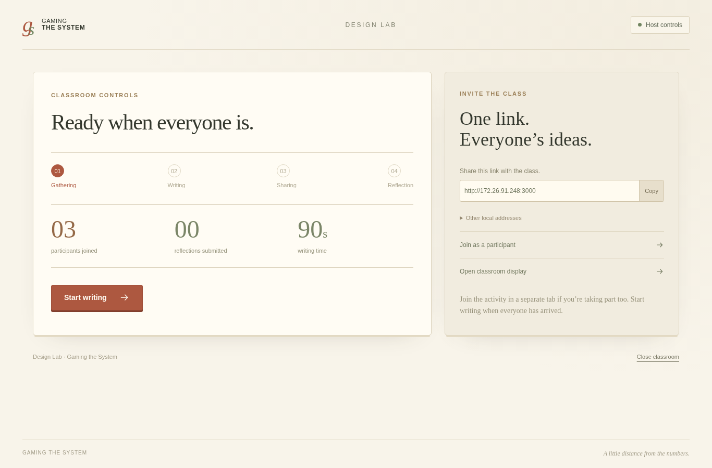
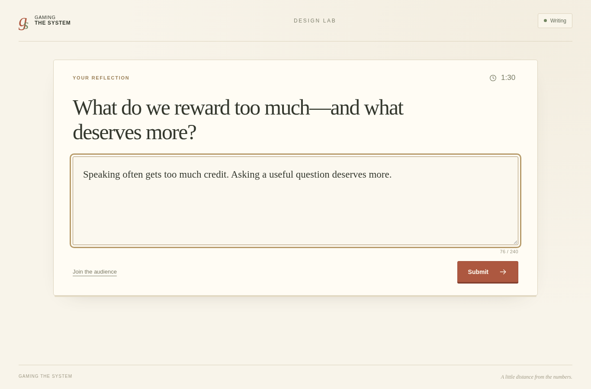
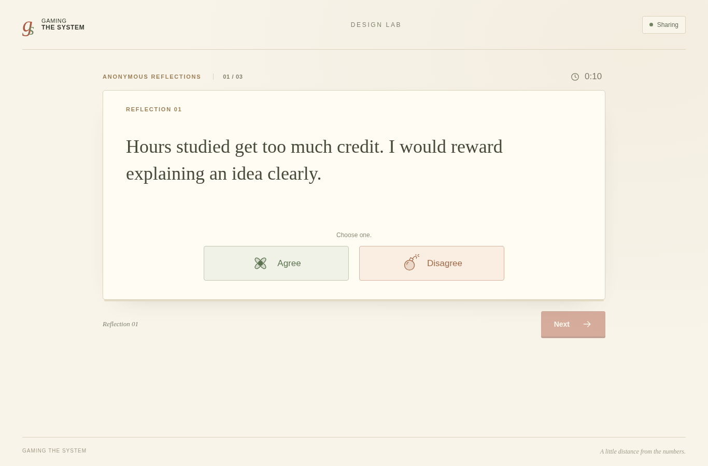
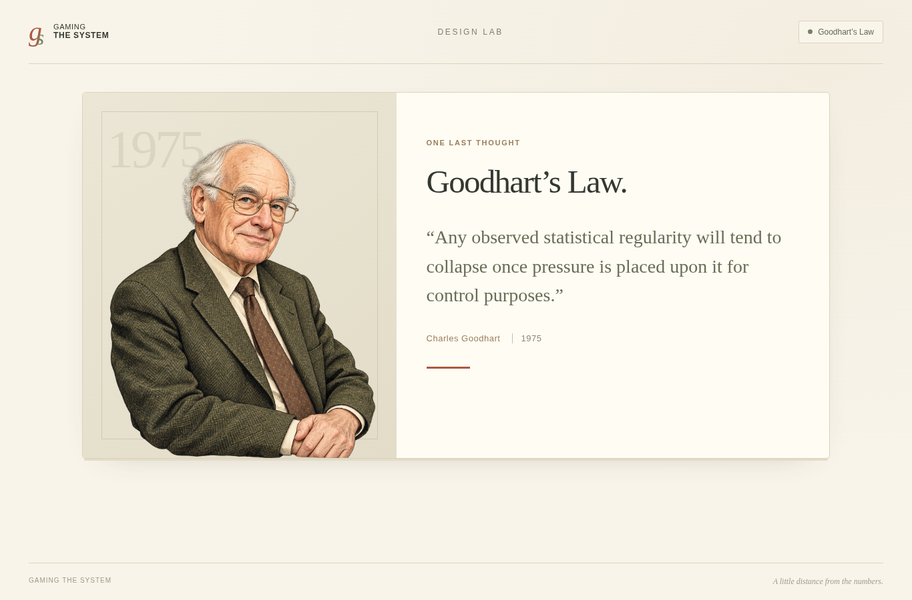

# Design Lab · 本地课堂版

这是独立的 Design Lab，位于 `feature/design-lab-local`，**尚未接入三关游戏**。
它由老师的 Windows 电脑临时提供网页；学生仅需浏览器。同一局域网可互通即可运行，
无需云服务器、账号、Python、Node.js 或订阅，也没有按人数收费的服务。

## 下载与启动（老师）

下载 [Design-Lab-local.zip](https://github.com/suojin311-creator/gamingthesystem_game/blob/feature/design-lab-local/play/Design-Lab-local.zip?raw=true)。

1. **先完整解压**，双击 `Start-Design-Lab.exe`。支持 Windows 10/11 64 位。
2. 浏览器会自动打开主持页。启动程序的窗口保持打开。
3. 主持页右侧显示可分享给同学的网址。老师电脑和同学电脑需要处于可互通的网络。
4. 如老师也参与，点击 **Join as a participant**，在新标签页作答。主持页本身不占参与名额。
5. 等大家加入后，点击 **Start writing**。
6. 固定 90 秒写作后自动进入展示。每份最多 10 秒；选择鲜花／炸弹后，可点 Next 提前继续。
7. 提前完成的人等候。全员完成或展示期限到达后，显示同一份最终排名，然后依次出现两个反问。
8. 第二个问题停留供讨论。主持页点击 **Show Goodhart’s Law**，显示结束画面。
9. 下课点击 **Close classroom**。程序退出，本次数据随之清空。

首次启动若 Windows 防火墙询问，请允许该程序在课堂使用的网络上接收连接。
不要在活动期间关闭启动程序窗口、让老师电脑休眠或断网。

## 一个人先检查界面

主持页点击 **Join as a participant**，即可自己走一遍写作和收尾。
要体验真实投票，可再用其他浏览器或隐私窗口打开参与者链接，模拟其他人。
同一个参与者标签页刷新会恢复当前 Lab 状态；新活动需要关闭程序后重新启动。

## 课堂网络自测

先启动程序，在另一台电脑输入主持页分享的网址。
能看到 Design Lab 等候页，并让主持页的加入人数增加，即已完成实际连通测试。
如老师电脑可访问、其他电脑不行，检查地址、防火墙及校园网络隔离。
主机有多张网卡时，可展开 **Other local addresses**，选择当前课堂网络的地址。
还需在正式课堂使用的网络上完成一次测试；云开发环境不能验证校园网。

## 已确认的规则

- 最多按 20 位学生＋1 位老师使用设计；主持页面不额外算人。
- 写作题目：**What do we reward too much—and what deserves more?** 无题目下方小字。
- 最多 240 字符，供 10 秒内阅读；支持中文与英文。
- 开始前说明匿名展示、投票及最终排名，不说明计分细节。
- 只有 **Agree（鲜花）／Disagree（炸弹）**；只接受第一次选择。
- 超时自动切到下一份；未作选择不计票。选择后可提前点击 Next。
- 自己的作品也在序列中，可以直接跳过，不接受自投。
- 21 份作品的全局展示上限为 210 秒；N 份为 N × 10 秒，全员提前完成时立即结束。
- 鲜花数降序；同分并列相邻，采用 1、2、2、4 这样的名次，组内沿用一次随机顺序。
- 排名在展示结束时冻结；高光框由慢到快滑向末尾，约 5 秒。
- 第一个问题自动展示 7 秒；第二个问题等老师结束讨论后再进入 Goodhart 画面。
- 不收集姓名、不连接游戏数据，不将活动内容写入文件或第三方服务。进程关闭后清空。
- 不增加防捣乱、审核或排行榜互动功能。主持操作只在老师电脑上开放。

## 技术与开发

前端复用仓库已有 React / TypeScript / Framer Motion，单独使用 Vite 构建。
Go 服务只依赖标准库，嵌入全部前端和插画，交叉编译成 Windows 单文件程序。
HTTP 监听局域网；主持页 `/host`，参与者页 `/`，投影页 `/display`。
所有阶段、截止时间、锁定的选择和最终排名由本地服务管理；浏览器按自己的进度显示作品。

```sh
# 仓库根目录；首次需要 Node.js 与 npm ci
npm run lab:build

# 使用真正的 Go 1.22+ 工具链
cd design-lab
go test -race ./...
go build -o build/design-lab-local .
./build/design-lab-local --no-browser --port 3000

# 另一终端在仓库根目录运行，按需热更新前端
npm run lab:dev

# 发布独立 Windows ZIP（在仓库根目录）
npm run lab:package
```

如果系统的 `go` 不是 Go 编译器，可通过 `DESIGN_LAB_GO` 指定真实路径。
源码、启动器构建和测试都与原游戏隔离；不需要重建游戏动画或原来的六个 ZIP。

浏览器验证：`python3 design-lab/tests/browser.py --scenario all`。
测试使用缩短的写作时间，但卡片真实等待 10 秒；Go 时钟测试覆盖正式 90／210 秒上限。
测试中使用同源码的 Linux 服务；Windows 产物另做 PE 架构和嵌入资源校验。
不能将 Linux 测试描述为已经在 Windows 实机运行；发布前后仍需用老师电脑实际启动一次。

## 结尾素材

半身像是为本项目生成的插画，非历史照片。引文采用 Goodhart 1975 年的原始表述：
“Any observed statistical regularity will tend to collapse once pressure is placed upon it for control purposes.”
出处：Charles A. E. Goodhart, *Problems of Monetary Management: The U.K. Experience* (1975)。

## 界面预览





